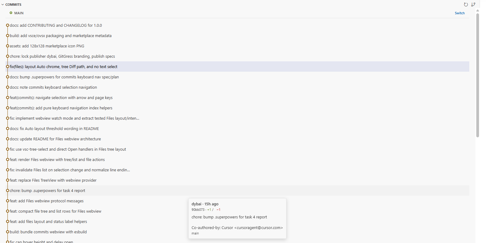
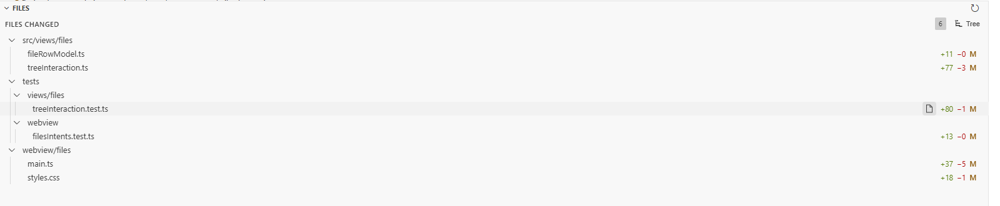

# GitGress

[English](README.md)

GitGress 是面向 VS Code / Cursor 的扩展：以多车道提交图浏览 Git 历史（含 merge
分叉）、无限滚动加载更早提交、查看所选提交变更文件，并对照父提交打开 diff。

## 截图

## 安装

### 扩展市场

- **VS Code：** 在扩展视图搜索 **GitGress**（`dybai.gitgress`），或在 Visual Studio Marketplace 发布后安装。
- **Open VSX / Cursor：** 搜索 **GitGress**，或在 Open VSX 发布后安装。

### VSIX / GitHub Release

1. 从 [Releases](https://github.com/dybai/gitgress-plugins/releases) 下载 `gitgress-1.0.0.vsix`。
2. 在 VS Code 或 Cursor 中执行 **Extensions: Install from VSIX…** 并选择该文件。

## 环境要求

- 支持 `engines.vscode` `^1.85.0` 的编辑器（VS Code 或 Cursor）
- 系统 `PATH` 中可用 **Git 2.24+**
- 打开的工作区文件夹为 Git 仓库

## 功能

- 多车道 SVG 提交图（含 merge 拓扑）
- 历史无限滚动分页
- 提交悬停浮层（无头像，滚动时保持对齐）
- 所选提交的 Files 视图（列表 / 树 / 自动布局）
- 从 Files 打开相对父提交的 diff
- Commits 键盘选择导航（方向键、Home、End、PageUp、PageDown）

## 用法

1. 打开 Git 仓库文件夹。
2. 在活动栏选择 **GitGress**。
3. 在 Commits 中浏览历史；悬停查看详情；单击选中。
4. 在 Files 中查看变更路径；双击（或打开 Diff）查看相对父提交的差异。
5. 使用视图标题栏切换分支或刷新（都会重置分页）。

### Files 视图说明

- 布局在 **Auto → List → Tree → Auto** 间循环，并按工作区持久化（`gitgress.files.layout`）。
- **Auto**：变更路径 ≤ 5 用列表，否则用树。
- 单击选中行；双击打开相对父提交的 diff。
- **Open File** 打开工作区工作树文件（删除的路径不可用）。

## 从源码开发

见 [CONTRIBUTING.md](CONTRIBUTING.md)。

## 许可证

[MIT](LICENSE)
